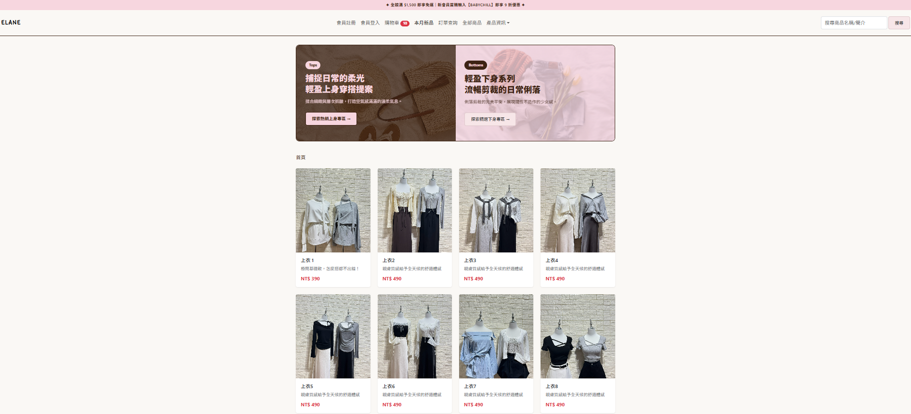
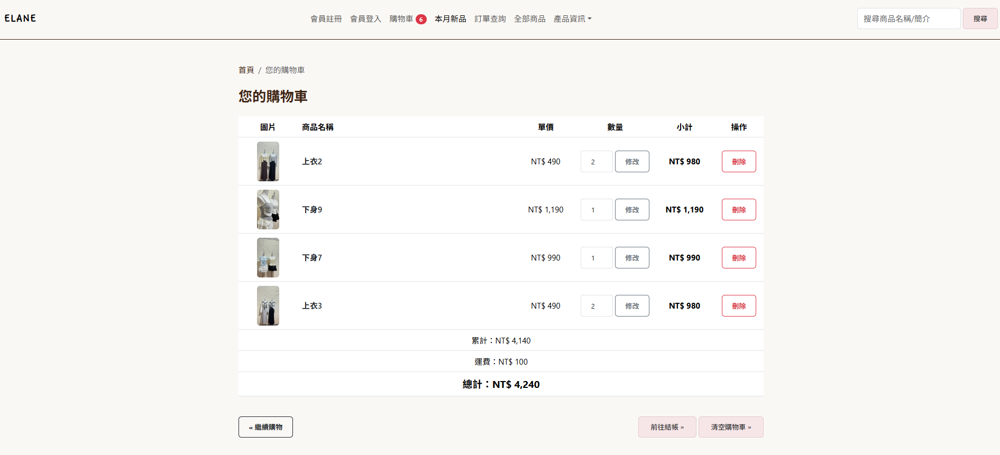

# ELANE 女裝電商網站

以 PHP + MySQL (MariaDB) 開發的女裝線上購物網站,涵蓋商品瀏覽、分類、搜尋、購物車與結帳流程。目前為**開發中**,前台購物流程已可運作,會員、金流與後台管理仍在製作。

> 品牌風格:莫蘭迪粉 / 奶茶色系,主打「優雅與隨性並存」的日常穿搭。

<!-- 在這裡放截圖,例如:


-->

---

## 功能狀態

### 已完成
- **商品列表**:僅顯示上架商品、每頁 8 筆分頁、懸浮「立即選購」按鈕
- **商品分類**:導覽列多層下拉選單(大分類 → 子分類),點選大分類自動帶出底下所有子分類商品
- **關鍵字搜尋**:同時搜尋商品名稱與簡介
- **商品詳細頁**:多圖縮圖切換、Fancybox 彈窗輪播
- **麵包屑導覽**:依頁面情境(分類 / 商品 / 搜尋 / 購物車 / 結帳)自動產生
- **購物車**:AJAX 加入購物車(不換頁)、導覽列即時更新件數、修改數量、刪除單項、清空購物車
- **結帳頁**:商品明細、累計、運費、總計(收件人與付款資訊目前為示意資料)
- **安全性**:資料庫操作使用 PDO prepared statement,輸出內容使用 `htmlspecialchars()` 防 XSS
- **響應式設計**:Bootstrap 5,支援桌機與手機

### 開發中 / 規劃中
- [ ] 會員註冊、登入、登出(登入頁面 UI 已完成,後端驗證製作中)
- [ ] 訂單建立與訂單查詢
- [ ] 金流串接
- [ ] 後台管理系統(商品、分類、訂單管理)
- [ ] 前台 UI / UX 優化
- [ ] 購物車改以 session / 會員帳號綁定(目前以 IP 辨識訪客)
- [ ] 上線前強化:資料庫專用帳號、HTTPS

---

## 技術架構

| 類別 | 使用技術 |
|------|----------|
| 後端 | PHP 8.2、PDO |
| 資料庫 | MariaDB 10.4 / MySQL |
| 前端 | HTML5、CSS3、JavaScript (Fetch API)、Bootstrap 5.3 |
| 套件 | Fancybox 5(圖片彈窗)、Bootstrap Icons、Google Fonts |
| 開發環境 | XAMPP (Apache + MariaDB)、phpMyAdmin、VS Code |

---

## 專案結構

```
├── connections/
│   ├── conn_db.php          # 資料庫連線(不納入版控)
│   └── conn_db__php.example # 連線設定範本
├── index.php                # 首頁 / 商品列表入口
├── product_list.php         # 商品列表、搜尋、分類篩選、分頁
├── product_detail.php       # 商品詳細頁
├── cart.php                 # 購物車(查詢 / 修改 / 刪除)
├── addcart.php              # 加入購物車 API(回傳 JSON)
├── shopcart_del.php         # 刪除單項 / 清空購物車
├── checkout.php             # 結帳頁
├── login.php                # 會員登入頁
├── header.php               # 共用 <head>
├── navbar.php               # 導覽列(含動態分類選單)
├── breadcrumb.php           # 麵包屑導覽
├── footer.php               # 頁尾
├── php_lib.php              # 共用函式(分頁產生器等)
├── js_lib.php               # 共用 JavaScript(AJAX 加入購物車)
├── style.css                # 全站樣式
├── product_img/             # 商品圖片
├── bg_img/                  # 背景圖片
└── sql/
    ├── newstore.sql         # 資料庫
    ├── product.sql          # 商品資料表
    └── pyclass.sql          # 商品分類資料表
```

---

## 資料庫

資料庫名稱:`newstore`

目前前台主要使用以下資料表:

| 資料表 | 說明 |
|--------|------|
| `product` | 商品(名稱、簡介、價格、上架狀態、分類) |
| `product_img` | 商品圖片(一個商品多張,`sort=1` 為主圖) |
| `pyclass` | 商品分類(`level` 階層、`uplink` 上層分類) |
| `cart` | 購物車(商品、數量、狀態、訪客 IP) |

其餘資料表(會員、訂單、收件地址等)為後續功能預留。

---

## 本機安裝

1. 安裝 [XAMPP](https://www.apachefriends.org/),啟動 **Apache** 與 **MySQL**
2. 將專案放入 `htdocs/` 資料夾
3. 開啟 phpMyAdmin,建立資料庫 `newstore`,匯入 `sql/newstore.sql`
4. 複製連線範本並填入自己的設定:
   ```bash
   cp connections/conn_db__php.example connections/conn_db.php
   ```
   ```php
   $dsn = "mysql:host=localhost;dbname=newstore;charset=utf8";
   $user = "root";
   $password = "";
   ```
5. 瀏覽器開啟 `http://localhost/<專案資料夾>/index.php`

---

## 技術重點

- 使用 **PDO prepared statement** 操作資料庫,避免 SQL Injection
- 加入購物車採 **Fetch API + JSON**,不需重新整理頁面
- 分類篩選自動判斷大分類 / 子分類,以子查詢 `IN (SELECT ...)` 取出所有下層商品
- 麵包屑依 URL 參數與資料庫分類階層動態組合
- 敏感設定(`conn_db.php`)以 `.example` 範本管理,不上傳至版控

---

## 作者

- 姓名: Roux
- Email: rouxchen.code@gmail
- 作品集 / LinkedIn:

---

*此專案為個人學習與作品集用途,商品名稱與圖片皆為示範資料。*
